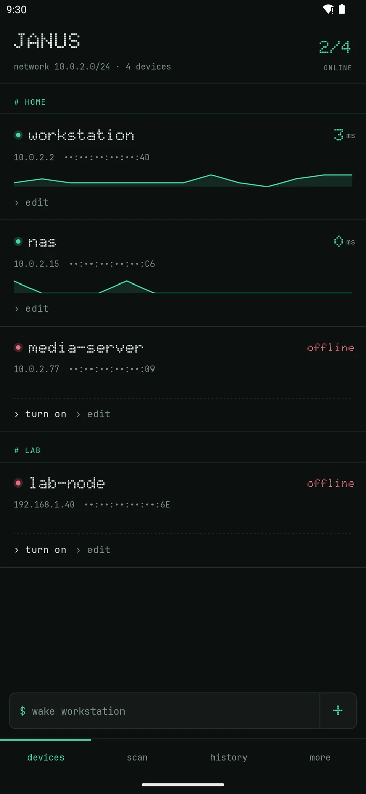

# Janus

**Turn your computers on from home and off from anywhere.** An Android app that wakes machines with a
Wake-on-LAN magic packet, shuts them down over SSH, and pings them over ICMP, without root, to show
which ones are online. Janus is the Roman god of doors, beginnings and endings, with two faces: one turns
your machines on, the other turns them off, and the door is your home network.

[](https://github.com/YmidOrtega/Janus/actions/workflows/build.yml)
[](https://developer.android.com/)
[](shared-build.gradle)
[](LICENSE)

<p align="center">
  
</p>

<sub>The device list on an emulator. The two online devices answer a real ICMP ping, and the line under each
one is its recent latency. The command bar takes typed commands like `wake workstation`.</sub>

## Waking is easy, shutting down is not

Wake-on-LAN only goes one way: there is no magic packet that turns a machine off. Janus closes the loop
with SSH. It logs into the machine with a password or a private key and runs the shutdown command you set
for that device, for example `sudo shutdown -h now`. Remote shutdown works on Linux machines.

At home both directions are direct: the magic packet goes out as a broadcast and SSH goes to the local IP.
From outside, the intended route for shutting down is a VPN into your network, such as WireGuard on the
same PC, so SSH is never exposed to the internet. A WAN address and port can be set per device for routers
that forward the magic packet.

## Credentials that can't leak

The app stores what it takes to log into your machines, so it treats them that way:

- **Encrypted database.** Devices and their SSH credentials live in Room on SQLCipher. The passphrase is
  random, generated on first launch, and kept in the Android Keystore, never in the code. A plaintext
  database from an older version is encrypted in place on startup.
- **Host keys pinned on first use.** The first SSH connection stores the host key fingerprint. If it ever
  changes, Janus refuses to connect instead of sending your password to a machine that may not be yours.
- **Biometrics or PIN before acting.** Editing a device always asks. Waking and shutting down skip it only
  on Wi-Fi networks you mark as trusted, and never when the request comes from outside the app (voice, a
  tile, a shortcut).
- `allowBackup` is off, so the database never leaves the phone in a cloud backup.

## What it does

- **Wake** with a magic packet over LAN or WAN, with an optional SecureOn password.
- **Shut down** over SSH, with a password or a key, and a step-by-step connection test.
- **Live status.** Unprivileged ICMP sockets from the `ping` module, falling back to
  `InetAddress.isReachable`; a background check every 15 minutes notifies you when a device comes up or
  goes down.
- **Network scan** that discovers devices on the LAN and marks the ones already saved.
- **Command bar.** `wake workstation`, `off nas`, `apagar ubuntu`: verbs in English, Spanish and German.
- **Voice.** Google Assistant App Actions (`OPEN_APP_FEATURE` with per-device shortcuts) and a Bixby
  capsule.
- **Without opening the app.** Three Quick Settings tiles, Device Controls, a home screen widget, per-device
  launcher shortcuts and a launcher icon that shows whether your devices are on.
- **History** of every wake and shutdown, groups, and JSON export and import.
- English, Spanish and German.

Firebase (Crashlytics, Analytics, Remote Config) is optional: the app builds and runs without
`google-services.json`. Remote Config can switch background monitoring off without shipping an update.

## Build it

JDK 17 and the Android SDK (compileSdk 36):

```bash
git clone https://github.com/YmidOrtega/Janus.git
cd Janus
./gradlew assembleDebug        # app/build/outputs/apk/debug/app-debug.apk
```

Release builds read their signing config from Gradle properties: `UPLOAD_KEYSTORE_PATH`,
`KEYSTORE_PASSWORD`, `KEY_ALIAS` and `KEY_PASSWORD`.

## Testing

```bash
./gradlew :app:testDebugUnitTest     # 147 JVM tests
./gradlew connectedAndroidTest       # UI tests on a device or emulator
```

The unit tests cover the magic packet, MAC, address, port and SecureOn validation, the command bar parser,
App Actions fulfillment and the shutdown model.

GitHub Actions builds every push. The `Jenkinsfile` runs the unit tests, builds the release bundle and
publishes it to Google Play: `master` to beta at 20 %, `release` and `develop` to internal testing.

## Project layout

```
app/src/main/java/com/ymid/wakeonlan/
├── wol/            Magic packet builder and sender
├── shutdown/       SSH shutdown (sshj) and the connection test
├── security/       Biometric gate, Keystore keys, host key pinning
├── persistence/    Room + SQLCipher, migrations, repositories
├── monitoring/     Background reachability and launcher icon workers
├── ui/             Device list, scan, history, backup, onboarding, settings
├── appactions/     Google Assistant deep links
├── quicksettings/  Quick Settings tiles
├── quickaccess/    Device Controls
├── widget/         Home screen widget
└── shortcuts/      Dynamic launcher shortcuts
ping/               Unprivileged ICMP ping library
bixby/              Bixby capsule
```

## Documentation

| Document | Content |
|---|---|
| [`AGENTS.md`](AGENTS.md) | Guide for agents and contributors: architecture, persistence and gotchas |
| [DeepWiki](https://deepwiki.com/YmidOrtega/Janus) | Generated walkthrough of the codebase |
| [ymid.me](https://www.ymid.me/projects/janus) | The story behind it, with a video on a real phone |

## License

GPL-2.0. See [LICENSE](LICENSE).

---

<div align="center">

**Built with ☕ Java and ⚡ Wake-on-LAN**

**by [Ymid Ortega](https://github.com/YmidOrtega)**

[](https://github.com/YmidOrtega)
[](https://linkedin.com/in/ymidortega)

*If you found this project useful, consider giving it a ⭐!*

</div>
